# Frosthold Outpost

An original survival and town-building game for phones and desktop browsers. Lead a frozen settlement: gather wood, food, stone and crystal, keep your people warm and fed, wall in the fort, and grow it from a camp into a castle while raiders strike each night and monsters roam the wilds.

Open `index.html` in a browser. There is no build step; three.js r128 loads from cdnjs. This file is also the in-game **Help** (cog menu), so keep it up to date with every change.

## Getting started
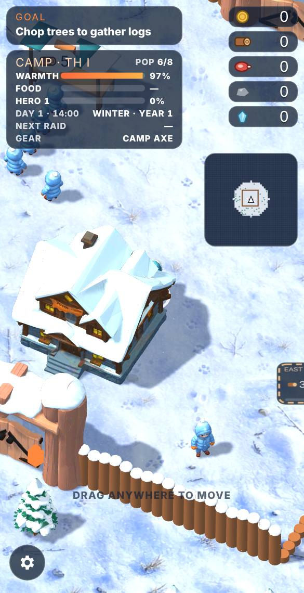
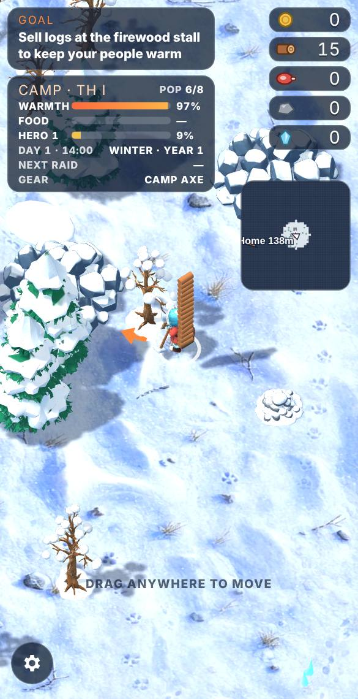
- **Move:** swipe (drag) anywhere on the screen for a floating joystick, or use WASD / arrow keys.
- **Gather:** your axe swings on its own at trees, rocks, animals and enemies in reach. What you gather stacks on your back.
- **Build and buy:** stand on a build space for a moment and it starts taking what you carry and your gold (the short pause stops you paying by accident when you walk across one).
- **Sell:** stand in the dashed spot behind a stall's counter to hand over logs (firewood stall) or food (cookhouse). Villagers buy them for gold.
- **The GOAL card** (top left) always says what to do next; the orange arrow on the ground points the way.
- A new game starts with a short **Tutorial**; **Skip tutorial** closes it, and **Tutorial** in the cog menu replays it.

## Survival
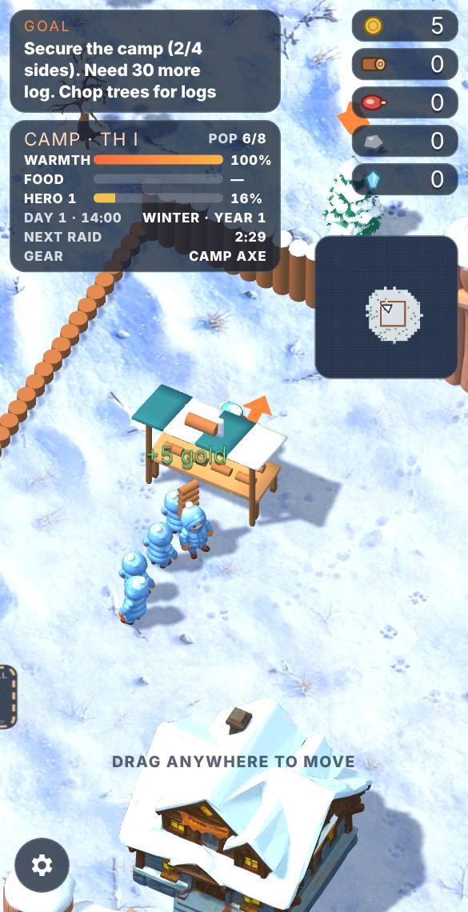
- **Warmth:** every villager burns firewood. Sell logs at the firewood stall to keep the warmth meter up. Each log gives 1 warmth at Town Hall I, 2 at II and 3 at III, and bigger towns buy faster. Blizzards (winter, from Town Hall II) burn firewood 2.5× faster.
- **Food:** once the cookhouse is built, villagers also eat. Sell meat, fish and veggies there; each food item lasts three times as long as a log.
- If either meter hits zero, villagers start dying. Lose them all and Frosthold falls.
- With both meters above half and free beds, new villagers arrive. They pay taxes to the Town Hall.
- **Housing:** each house holds 4; **Bunk Beds** (Town Hall II) raise that to 7 and **Stone Lofts** (Town Hall III) to 10; each Town Hall and Castle level adds more. Workers and guards live in their lodges and barracks, so they don't take beds.

## Food sources
- **Rabbits** (1 food) and **deer** (2–3 food) graze in large numbers around the settlement.
- **Yaks** (5–6 food) and **boars** (5–6 food, they charge back when hurt) keep to the far meadows, 130 m and more out. **Eagles** circle the far meadows too.
- **Garden** (after the cookhouse): veggies pile up beside it, fastest in summer.
- **Fishery** (Town Hall II) and **fishing** (see below).

## Fishing
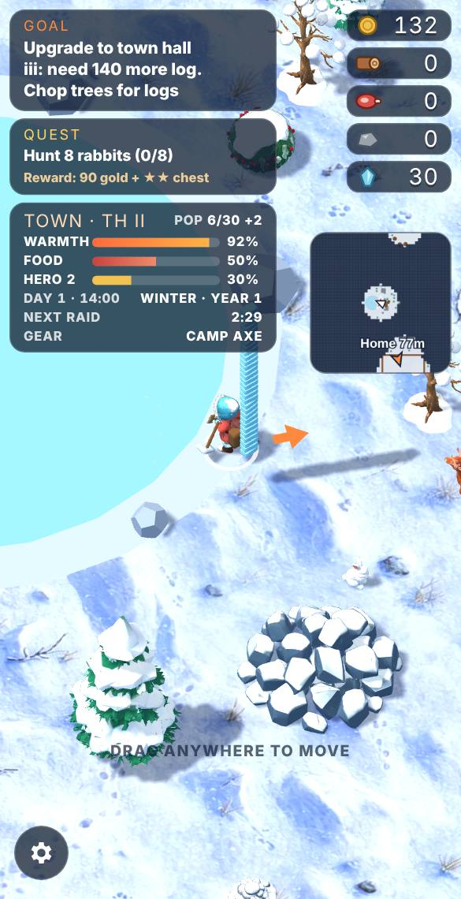
Stand still at a lake's edge (or out on the ice in winter, where you cut a hole) and you cast automatically. After a few seconds you catch 2–4 fish, more at far lakes. Now and then you reel in a sunken treasure chest. Fishing stops if raiders are close.

## Days, nights and seasons
- A day lasts **6 minutes**; the last part is night: darker, colder and more dangerous.
- Every 2 days the season turns: winter, spring, summer, autumn. Summer needs the least firewood, winter the most. Lakes block your path except in winter, when they freeze.
- **Every day is harder:** raiders get more health and hit harder, raids get bigger, camp monsters are tougher, and firewood and food burn faster (up to double).
- At night, **workers drop off what they carry and go home** until morning.

## Raids and defense
- **One raid a night, at nightfall.** Raiders are a mix: wolves and goblins at first, then spiders, bears, trolls, yetis and wraiths. Raiders who can't break through give up after 3 minutes.
- Raiders chew through walls; broken sections show a cheaper rebuild space. They go after workers caught outside the walls first.
- **Watchtowers** shoot anything in range; every corner of every wall ring has a tower spot. Each tower has its own upgrades (Crossbows, Ballista, Frost Spire).
- **Blacksmith defense upgrades:** Arrows II/III (all towers), **tower range** (Spyglasses, High Perches, Eagle Eyes: +4 m each), **wall reinforcement** (Iron Bands, Stone Bastions, Rune Wards: +75% wall strength each) and Masonry.
- **Guards** (Barracks, Town Hall II) post at all four gates, north, south, east and west in turn, and fight raiders nearby.

## Building the town
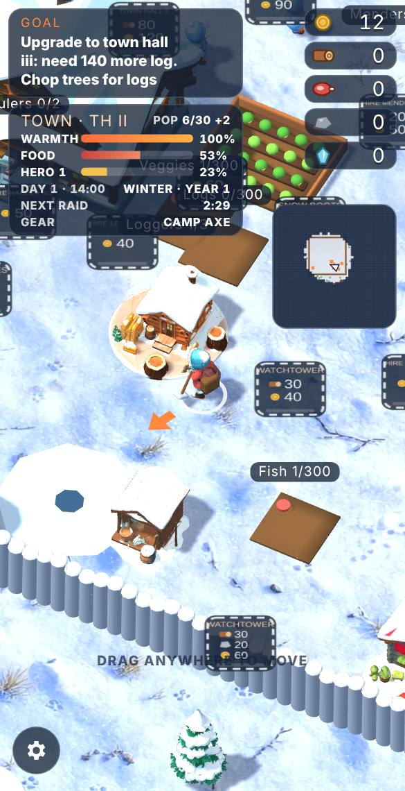
| Tier | Goal | Unlocks |
|---|---|---|
| Camp (Town Hall I) | Rebuild the camp palisade | Cookhouse, garden, houses, watchtowers, blacksmith, logger lodge |
| Town (Town Hall II) | Wall in the town square | Barracks, hunter lodge, warehouse, quarry lodge, fishery, med center, more houses and towers |
| Citadel (Town Hall III) | Raise the citadel wall | Crystal mine, miner camp, crystal trader, treasury, carpenter, guard drill |

Finishing a new wall ring tears down the old one and clears the forest inside it. Town Hall upgrades need the current ring fully secured.

## Castle and the final battles
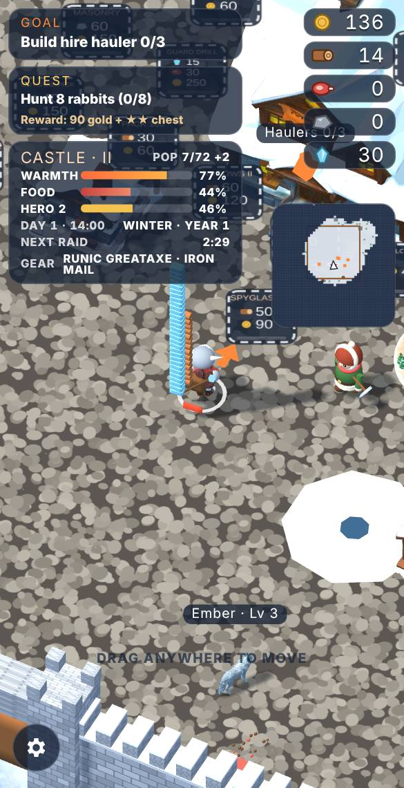
After Town Hall III and the citadel wall, the Town Hall space offers **Castle I, II and III**. Each level:
- turns the hall into a bigger stone keep, every wall into brick stone with battlements, towers into round stone towers, gates into stone gatehouses, and paves the keep with cobblestones;
- makes walls, towers and guards much stronger, adds housing, and allows two more **guard battalions** (Train Battalion raises three guards at once);
- also makes the nightly raids much bigger and tougher.

At **Castle III** the final battles begin: each night brings a **dragon siege** (one dragon, then two, then three, with a large escort). Defeat all three for **victory**; you can keep playing after.

## Workers
- **Loggers, hunters, stonecutters and miners** gather on their own and stack what they collect on a pile beside their lodge. Stand on a pile to load your pack. Piles hold 80, or 300 after the Warehouse.
- **Hunters** stay near the settlement and hunt rabbits and deer.
- **Tap a pile's label** to lock it (a padlock shows): haulers won't take from a locked pile, so you can save it for building. Tap again to unlock.
- **Haulers** carry logs to the firewood stall and food to the cookhouse, serving whichever meter is lower first.
- **Menders** walk the walls and repair damaged sections.
- Each building shows how many of its workers you have (for example **Loggers 2/3**). A hire space disappears when you can't hire more; it returns when the next Town Hall or Castle level raises the limit.
- Workers have health; a worker who dies drops what they carried.

## Village upgrades
Three gold-only upgrade spaces sit around the plaza: comfort (supplies last longer), trade (more income) and folk (hero, workers and towers). Later upgrades wait for Town Hall II and III.

## Your hero
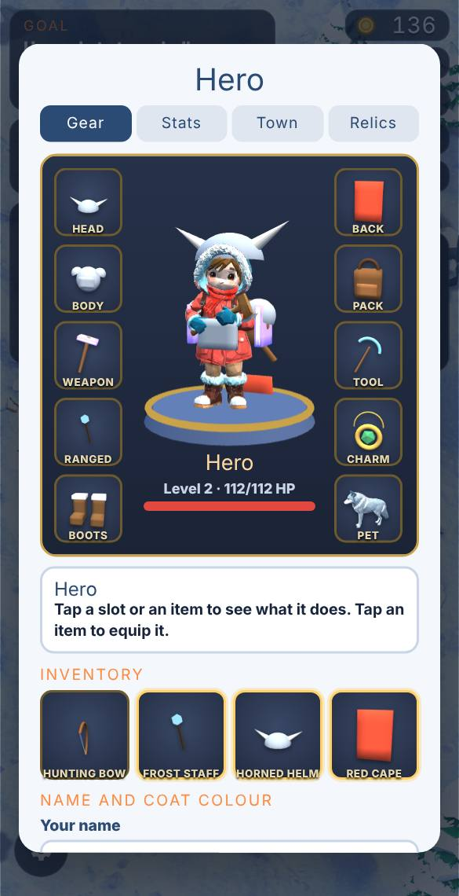
- **Hero levels** come from gathering, building, selling and fighting, and add damage and health.
- **Personal blacksmith upgrades:** axes (Twin Axes, Axe III, IV), packs (100, 200, 400), the **Crystal Pick** (to mine crystal), **boots** (Fur Boots, Runner Boots, Windwalkers: +12% speed each) and **ranged weapons** (below). In co-op each player buys their own.
- **The Hero screen** (cog → Hero): your 3D hero in their gear, equipment slots, an inventory of everything you own (tap an item to see it or equip it), plus Stats, Town and Relics tabs, and your name and coat colour.
- New gear is equipped automatically when it's better than what you have.

## Ranged weapons
A ranged weapon fires on its own at the nearest threat in range, alongside your axes. **Hunting Bow** (12 m), **Crossbow** (Town Hall II) and **Rifle** (Town Hall III) are forged at the blacksmith. Magic staffs come from treasure: the **Frost Staff** slows, the **Fire Staff** explodes, and the **Storm Staff** throws lightning that jumps to two more foes.

## Pets
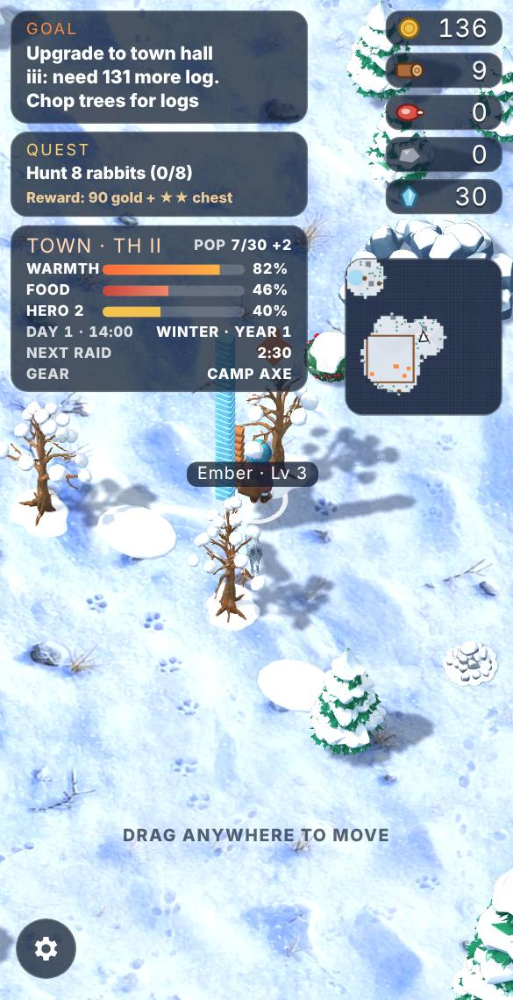
- Only a hero with a **Beast Charm** can tame. Earn one by slaying a quest legend, reaching hero level 10, or (rarely) from a treasure chest.
- Weaken a rabbit, eagle, wolf, bear, raptor, sabre tiger or ice dragon. When it's weak enough, a **Tame** button appears (with your odds) and a **Fight on** button lets you finish it off instead.
- Stand still beside it for two seconds. A failed attempt lets it recover some health.
- Name your pet when you tame it, and rename it from the Hero screen.
- A pet keeps 70% of its wild health and damage and is 80% of its wild size. It follows you, fights threats, hunts nearby animals when it's quiet, heals between fights, and **levels up** (+15% damage and more health each level).
- The **Pet** tab in the Hero screen shows your pet in 3D with its level, experience, health, damage, speed, total kills, raiders defeated, animals hunted, damage dealt and the day you tamed it.
- You keep one pet at a time. A pet that falls is gone for good.

## The wilds
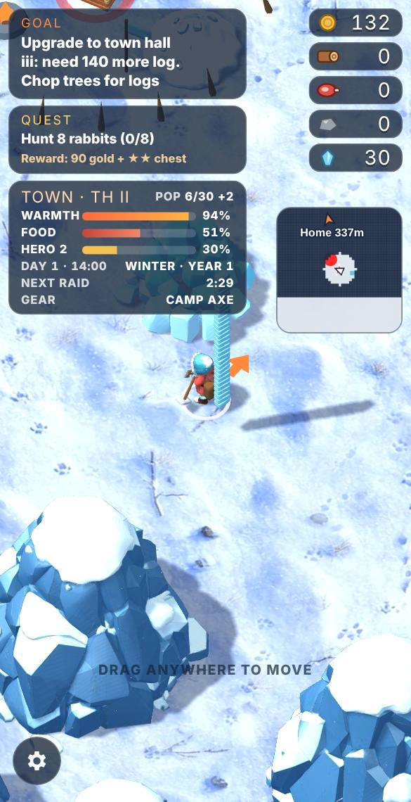
- The valley spans about 690 m. The minimap starts dark and reveals what you and teammates explore; drag it to move it anywhere on screen.
- **Monster camps** guard treasure chests (orange easy, red medium, purple dangerous, gold once cleared). Spiders, goblins and wolves near the fort; bears and trolls farther out; wraiths and golems at the edges. Goblins throw spears, trolls hurl rocks and wraiths cast chilling frost orbs: keep moving to dodge.
- **Beast lairs** past 250 m: raptors and sabre tigers, then mammoths, T-rexes and giant ice dragons past 300 m. They prowl and spot you from far away, but give the best loot.
- Past 300 m the land is rough: boulder fields, ice spires and deep snow that slows you.
- About 70 **unguarded chests** are scattered across the valley (gold diamonds on the minimap), and **ruins** each hide a cache you can search once.
- **Crystal veins** lie 255–345 m out and need a Crystal Pick.

## Treasure
Chests give weapons (Frostbite Axe up to Dragonbone Axe), armour (Fur Jerkin up to Dragonscale Plate), heart stones (+health), war runes (+damage), wind charms (+speed), storage charms (bigger piles), ember totems, yak totems, staffs, helmets, capes, med kits, the Beast Charm, gold and materials. Farther out means better loot.

## Quests
The Town Hall offers one quest at a time (the Quest card): hunt animals, collect resources, defeat a kind of monster, clear camps, or slay a named **legend** marked with a gold **!** on the minimap. Quests match your hero: at the start they stay close to home (rabbits, deer, logs, fish, wolves and goblins), and tougher monsters and the named legends only appear as your hero levels up (legends from hero level 5 or Town Hall II). Rewards grow with the quest: gold, XP and a reward chest.

## Dungeons
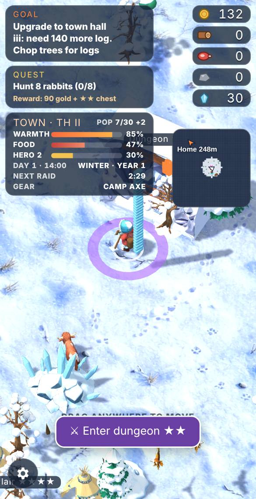
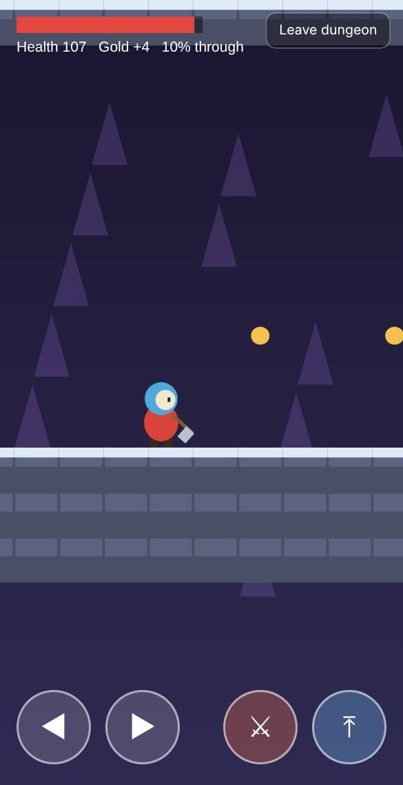
Twelve cave entrances lie 200–315 m out (purple squares on the minimap). Tap **Enter dungeon** to play a 2D side-scrolling level: run, jump over pits and ice spikes, stomp or axe slimes, skeletons and bats, and reach the chest at the end. Dungeons are drawn in a chunky pixel-block style, hero included. You can jump about four blocks high, enough to reach every ledge. You have **three hearts** (top left): every hit, spike or fall costs one, and losing all three sends you back to the entrance. Your gear and looks come with you. Controls: on-screen arrows, attack and jump buttons (or A/D, W/Space, J). Reach the chest for a treasure chest. A cleared dungeon refills after two days.

## Knockouts and revives
- You respawn at the Town Hall a few seconds after being knocked out; your pack spills where you fell.
- The **Med Center** (Town Hall II) revives you where you fell, once every 5 minutes.
- **Med kits** (Med Center, or treasure): stand next to a downed teammate for two seconds to revive them.

## Screen and menu
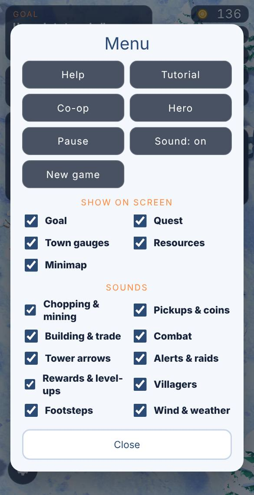
- On a keyboard, **1–4** turn collecting on or off: 1 wood, 2 stone, 3 food, 4 crystal.
- Tap a resource counter to **drop** it (all or 10) or **stop collecting** it. While collecting is off you still chop, mine and hunt, but nothing of that kind goes into your pack, and you can't load it from piles.
- The **cog** (bottom left) holds Help, Tutorial, Co-op, Hero, Pause, Sound and New game, switches to hide the goal, quest, town gauges, resources or minimap, and a switch for each kind of sound.

## Co-op
- **Room code (no account):** on the GitHub Pages site, tap **Co-op → Host a game** for a 4-character code and QR; friends tap Co-op and enter the code or scan the QR.
- **On claude.ai:** tap Co-op on the shared page; the first player hosts.
- Each player has their own hero, pack, wallet, gear and pet. Set your name and coat colour under Co-op or Hero; teammates appear with your name, colour ring and what you carry, and as a coloured star on the minimap.
- Stand next to a teammate and tap **Give** to hand over gold, resources or spare gear.
- Pausing in co-op only covers your own screen: the shared world keeps running for everyone, and your hero can't be hurt while paused.
- You get alerts when a teammate is under attack or knocked out. A phone that drops out or sleeps rejoins on its own. If the host refreshes the page, their room reopens with the same code and friends reconnect automatically within about 20 seconds, with their gear, pet, gold, pack and position just as they left them; **Leave co-op** closes the room for good.

## Saving
Progress saves automatically every few seconds and when you leave the page, in this browser only. **New game** (tap twice) starts over.

## Art
Models come from Meshy (`tools/meshy_assets.py`, cached so nothing is paid for twice) and the painted ground from OpenAI images (`tools/openai_texture.py`).
